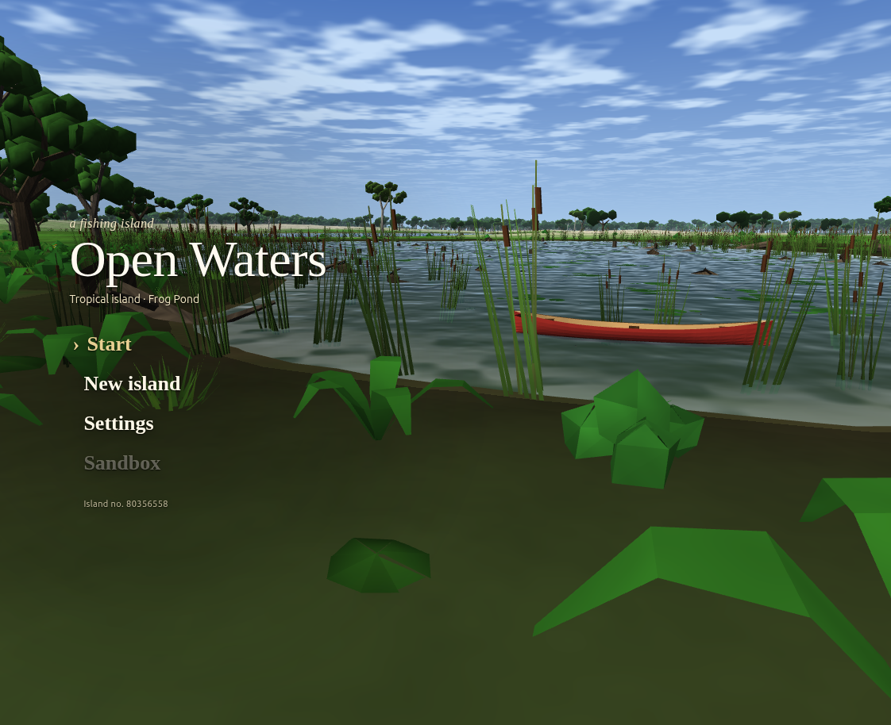
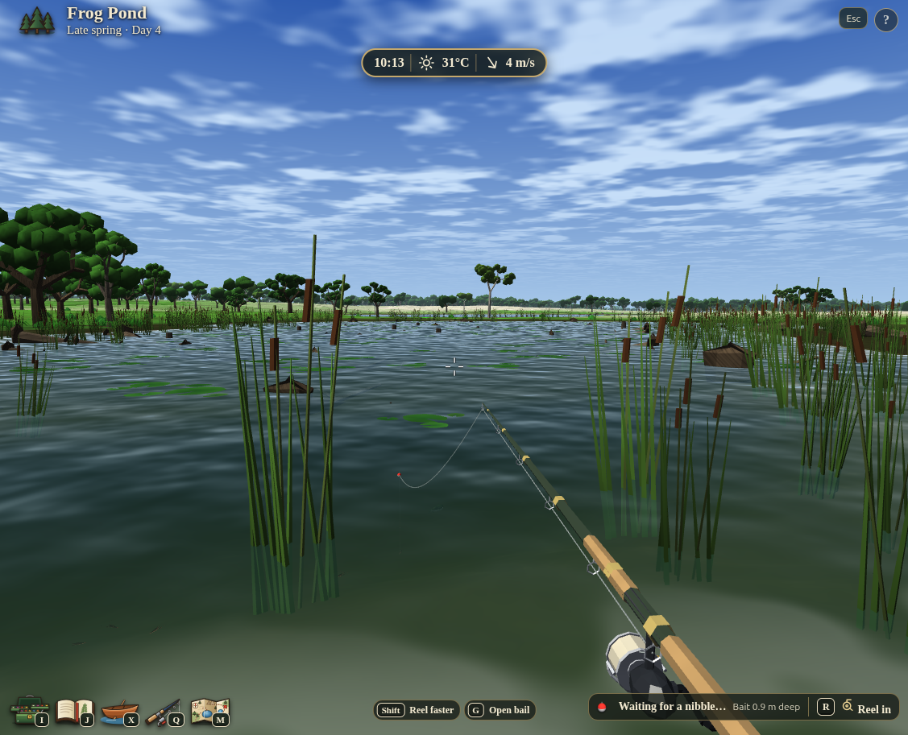
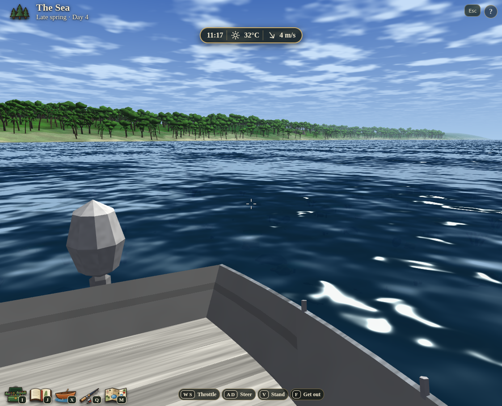
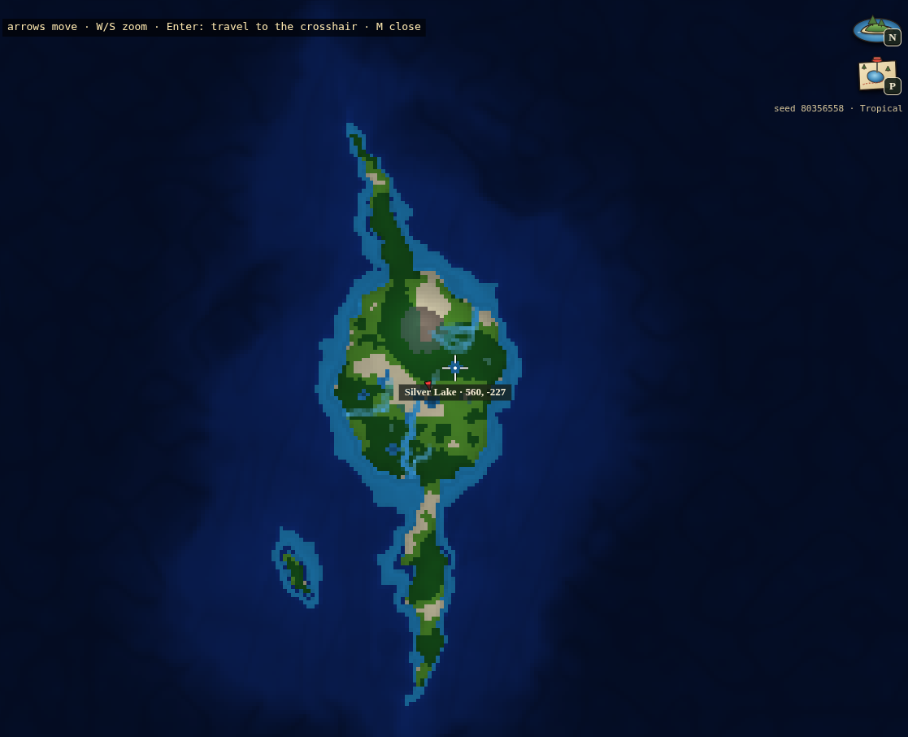

# Open Waters

A first-person fishing and exploration game that runs in the browser. It's built with WebGL2 and plain JavaScript, with no dependencies. The whole game ships as one file: **`Open Waters.html`**. Open it in a browser to play.



| Fishing at Frog Pond | Out on the sea | The island map |
| --- | --- | --- |
|  |  |  |

Every island is generated from a seed, with lakes, ponds, rivers and sea. It has seasons and weather, 119 fish species, boats, and tackle you build into rigs.

## Download

Play in the browser on **[itch.io](https://gra-nt.itch.io/open-waters)**, or get the desktop app:

| System | Download |
| --- | --- |
| Windows | [Installer](https://github.com/gr-ant/OpenWaters/releases/latest/download/Open-Waters-win-x64.exe) · [Portable, no install](https://github.com/gr-ant/OpenWaters/releases/latest/download/Open-Waters-win-portable.exe) |
| macOS | [Apple silicon (M1 and later)](https://github.com/gr-ant/OpenWaters/releases/latest/download/Open-Waters-mac-arm64.dmg) · [Intel](https://github.com/gr-ant/OpenWaters/releases/latest/download/Open-Waters-mac-x64.dmg) |
| Linux | [AppImage](https://github.com/gr-ant/OpenWaters/releases/latest/download/Open-Waters-linux-x86_64.AppImage) · [.deb (Ubuntu, Debian)](https://github.com/gr-ant/OpenWaters/releases/latest/download/Open-Waters-linux-amd64.deb) |

All versions are on the [Releases page](https://github.com/gr-ant/OpenWaters/releases). The apps aren't code-signed yet. On Windows, click **More info → Run anyway**. On macOS, right-click the app and choose **Open**. If macOS says it's damaged, run `xattr -cr "/Applications/Open Waters.app"` once.

## Editing

Edit the files in `src/`, then rebuild the single file:

```sh
python3 build.py
```

That writes `Open Waters.html`. It needs Python 3 and nothing else. Don't edit `Open Waters.html` by hand, because the next build overwrites it.

## Desktop app (Linux, Windows, macOS)

`electron/` wraps the built game in an Electron window. To run or package it on your machine:

```sh
cd electron && npm ci
npm start                                      # play in a desktop window
npm run game && npx electron-builder --linux   # or --win / --mac; output in electron/dist/
```

Push to the `desktop` branch (`git push origin main:desktop`) and GitHub builds all three and publishes them on the repo's Releases page. The builds aren't code-signed yet, so Windows SmartScreen and macOS Gatekeeper will warn the first time.

## Layout

```
build.py              inlines src/ into "Open Waters.html"
src/
  index.html          page markup, plus the list of every script and data file, in load order
  css/                styles, one file per part of the screen (glass.css last: the glass theme over them all;
                      tutorial.css: the tutorial card)
  js/
    config.js         engine overview and CONFIG (tuning knobs)
    controls.js       rebindable keys and presets
    world/            island generation, seasons and weather, water temperature, habitat, fish populations
    shaders/          GLSL for the lit world, water, particles and sky
    models/           mesh builder, trees, water plants, particle kinds
    creatures/        fish, cephalopods and shellfish, reptiles and amphibians
    engine/           the Engine object: loop, rendering, chunks, map, inventory, boats, fish behaviour, touch
    boats.js          boat definitions to hull meshes
    tackle.js         rods, reels, lines, lures, rigs: gear rules, validation, rig stats
    tackle-meshes.js  3D rod, reel, hook, lure, bait, float and sinker meshes
    fishing/          casting, bites, the fight, tackle box, nets and traps
    game-api.js       the public Game API
    hud/              on-screen interface, icons, journal, menu keyboard navigation, tutorial
    sounds.js         sound effects synthesized with Web Audio, defined as data
    birds/            birds: flight, landing, perching, swimming; species are data
    game.js           game-specific setup on top of the API
    urchin.js         music synthesizer (see Music below)
    boot.js           reads the built-in data and starts the game
  music/*.urchin      songs (CSLT-1 JSON)
  fish/*.json         one file per species   (schema "embercrown-fish/1")
  boats/*.json        one file per boat      (schema "embercrown-boat/1")
  tackle/*.json       one file per piece of gear or rig (schema "embercrown-tackle/1")
```

The scripts share one global scope and run in the order `src/index.html` lists them. Later files use names defined by earlier ones, so keep that order when you move things around.

## Adding a fish, boat or tackle item

1. Copy a similar `.json` file in `src/fish/`, `src/boats/` or `src/tackle/` and change it. Give it a new `id`, and use that id as the file name.
2. Add a matching line to `src/index.html` next to its siblings. For example:
   ```html
   <script type="application/json" data-builtin="fish" src="fish/my_fish.json"></script>
   ```
   A rig must come after the parts it uses.
   For a fish, set `habitat.climates` to the island climates it lives in (`"temperate"`, `"arctic"`, `"tropical"`). Water temperature then decides where it lives within that climate. Leave it out and the species can show up in any climate.
3. Run `python3 build.py`. It warns you about any file in `src/` that `index.html` doesn't list.

## Music

`src/js/urchin.js` is Urchin, a small synthesizer that plays CSLT-1 songs with 20 built-in instruments and no audio files. It's a copy of urchin's `src/urchin.js` plus one block at the end that exposes it as the global `Urchin`. To update it, copy the new `urchin.js` over and keep that block.

Songs live in `src/music/*.urchin` (CSLT-1 JSON). Each one is listed in `src/index.html` like this:

```html
<script type="application/json" data-song="my-song" src="music/my-song.urchin"></script>
```

Play a song from game code. Browsers only allow sound after a click or key press, so call this from an input handler:

```js
const player = await Urchin.playSong('my-song');   // also: Urchin.play(jsonOrObject), Urchin.instruments
player.stop();
```

See urchin's README for the song format (`A1P5@4q` means measure A, beat 1, instrument P, E4, a quarter note).

## Playing options

You can add these to the URL: `#seed-12345` picks a fixed world, and `#climate-…`, `#season-…` and `#weather-…` set the starting conditions.
